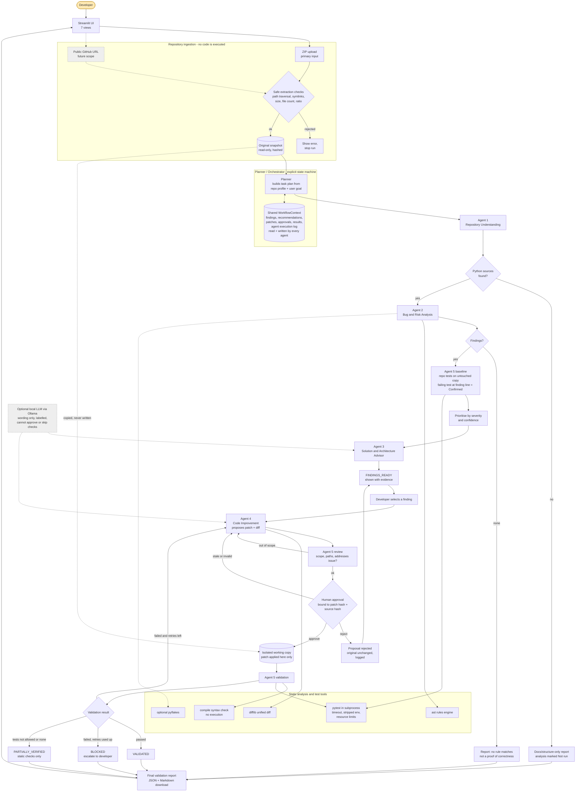

# CodeMind AI — Architecture and Technical Design

> Designed in Phase 1, updated after Phase 2 to match the implementation. Section 12 lists every place where the build differs from the original design.

## 1. Architecture diagram (CA-3 deliverable 4)

Source: [`docs/architecture.mmd`](docs/architecture.mmd) · rendered: [`docs/architecture.png`](docs/architecture.png), [`docs/architecture.svg`](docs/architecture.svg) (rendered with mermaid-cli 11.4.2 during Phase 1).



## 2. Why this is agentic and not a chatbot

- **Planning:** the Planner inspects the repo profile (languages found, tests present, README present, user goal) and emits an ordered `TaskPlan`; steps are skipped or added based on that profile (e.g. no Python → analysis steps marked *Not run*; no tests in repo → validation limited to syntax checks and reported as *Partially verified*).
- **Tool use:** every agent output comes from a real tool call (`zipfile`, `ast`, `difflib`, `py_compile`, `pytest` subprocess). There are no hard-coded agent messages.
- **Conditional workflow and decisions:** the orchestrator is a state machine whose transitions depend on previous agent results (§4).
- **Collaboration through shared structured state:** agents read and write typed dataclasses in one `WorkflowContext`; Agent 3 consumes Agent 2's findings, Agent 4 consumes Agent 3's recommendation, Agent 5 critiques Agent 4's patch and can send it back.
- **Controlled retry:** a failed validation sends structured feedback to Agent 4, which picks its next fix strategy; capped at 2 retries, then `BLOCKED`.
- **Human in the loop:** the workflow physically cannot leave `AWAITING_APPROVAL` toward patch application without an `ApprovalRecord` whose hashes match the current patch and source.

## 3. Agent roles

All agents implement `Agent.run(ctx: WorkflowContext) -> AgentResult` and append an `AgentLogEntry` (start/end time, inputs referenced, outputs produced, decision, errors). They are logical roles backed by deterministic Python; none needs an LLM.

| Agent | Inputs (from context) | Tools | Outputs (to context) | Key decisions |
|---|---|---|---|---|
| **Planner / Orchestrator** | `RepoSnapshot`, user goal | — | `TaskPlan`, state transitions, decision log | which steps run, what to do next, when to stop |
| **1. Repository Understanding** | `RepoSnapshot` | `readme_parser`, `metadata` (requirements.txt / pyproject / setup.cfg), `tree`, `ast` (module/function index, imports, `if __name__ == "__main__"` entry points) | `RepoSummary`: purpose (from README), technologies, entry points, modules with one-line roles, dependencies, internal import graph, documentation gaps — each with `Evidence` | whether Python analysis is possible; which files are relevant |
| **2. Bug & Risk Analysis** | `RepoSummary`, Python sources | `ast_rules` (R001–R009), optional `pyflakes` | `list[Finding]` with severity, confidence, evidence | confirmed vs. likely vs. potential; de-duplication |
| **3. Solution & Architecture Advisor** | `Finding`s, `RepoSummary` | alternatives knowledge base (`advisor_kb.py`), optional LLM for wording | `list[Recommendation]` (current vs. alternatives, pros/cons, trade-offs, recommended action, or "keep current") | whether an alternative is warranted at all |
| **4. Code Improvement** | selected `Finding`, its `Recommendation`, critic feedback on retry | rule-specific fixers (AST-located, text-applied), `difflib` | `PatchProposal` (edits, unified diff, root cause, affected files, regression risks, suggested tests, strategy index) | which fix strategy to try next |
| **5. Critic & Validation** | `PatchProposal`, working copy | scope checker, `py_compile`, sandboxed `pytest` runner | `CriticReview` (pre-approval) and `ValidationResult` (post-apply) | pass / fail / blocked / partial; request revision or escalate |

### 3.1 Finding confidence vocabulary

- **Confirmed** — reproduced by an executed test in the sandbox (only possible on the bundled sample or opted-in runs).
- **Likely** — strong syntactic pattern with low false-positive rate (e.g. `eval(` on a name derived from `input()`).
- **Potential** — pattern match that needs human review (e.g. division by a parameter with no visible guard).

## 4. Orchestration state machine

```
RECEIVED → PLANNED → ANALYZING → FINDINGS_READY → PATCH_PROPOSED → AWAITING_APPROVAL
         → PATCH_APPLIED_TO_COPY → VALIDATING → VALIDATED | VALIDATION_FAILED | PARTIALLY_VERIFIED | BLOCKED
```

| From | Event / condition | To | Notes |
|---|---|---|---|
| RECEIVED | snapshot accepted | PLANNED | ingestion errors → `BLOCKED` with reason |
| PLANNED | plan executed (A1→A2→A3) | FINDINGS_READY | A1 always runs before A2/A3 |
| PLANNED | no Python files | FINDINGS_READY | findings empty, analysis status *Not run* |
| FINDINGS_READY | user selects finding | PATCH_PROPOSED | A4 builds proposal |
| PATCH_PROPOSED | critic review fails (scope/path) | PATCH_PROPOSED | A4 regenerates with next strategy; counts toward retry cap |
| PATCH_PROPOSED | critic review ok | AWAITING_APPROVAL | proposal frozen, `patch_hash` computed |
| AWAITING_APPROVAL | **reject** | FINDINGS_READY | rejection logged; working copy untouched; original untouched |
| AWAITING_APPROVAL | approve with stale hash | AWAITING_APPROVAL | approval refused, error shown |
| AWAITING_APPROVAL | **approve** with matching hashes | PATCH_APPLIED_TO_COPY | fresh working copy created from original |
| PATCH_APPLIED_TO_COPY | — | VALIDATING | |
| VALIDATING | syntax ok + tests pass | VALIDATED | |
| VALIDATING | runtime tests disallowed / none exist | PARTIALLY_VERIFIED | static checks only, stated explicitly |
| VALIDATING | failure, `retries < MAX_RETRIES (2)` | VALIDATION_FAILED → PATCH_PROPOSED | feedback passed to A4; **new proposal needs new approval** |
| VALIDATING | failure, retries exhausted / no more strategies | BLOCKED | escalated to developer with all attempts |
| any | unexpected exception | BLOCKED | error captured in log; never silently continues |

Added during Phase 2: `PATCH_PROPOSED --no_strategy_left / critic_retries_exhausted--> BLOCKED`, and from `VALIDATED`, `PARTIALLY_VERIFIED` or `BLOCKED` the developer may select another finding or go back to the findings list. The authoritative table is `codemind/orchestrator/states.py`.

Implementation: a plain transition table (`dict[(State, Event), State]`) plus guard functions; illegal transitions raise `IllegalTransition`. Every transition appends a `DecisionRecord(from, to, event, reason, timestamp)`.

## 5. Bug & Risk rule set (deterministic baseline)

| ID | Rule | Category | Default severity | Confidence | Fix strategies (A4) |
|---|---|---|---|---|---|
| R001 | Division / modulo by a name or `len(...)` with no preceding zero-guard in the same function | Logic | High | Potential | 1) return a safe default; 2) raise `ValueError` with message |
| R002 | Bare `except:` or `except Exception: pass` (swallowed error) | Error handling | Medium | Likely | narrow exception + log/re-raise |
| R003 | `eval` / `exec` call | Security | High (Critical if arg traces to `input()`) | Likely | `ast.literal_eval` / explicit parsing |
| R004 | Mutable default argument (`[]`, `{}`, `set()`) | Maintainability/Logic | Medium | Likely | `None` sentinel |
| R005 | `subprocess.*(..., shell=True)` or `os.system` | Security | High | Likely | argument list, `shell=False` |
| R006 | Hard-coded secret: assignment to name matching `key|secret|token|password` with a string literal ≥ 8 chars | Security | High | Potential | read from `os.environ` (value **redacted** in evidence) |
| R007 | SQL built with f-string / `%` / `+` / `.format` passed to `.execute()` | Security | High | Likely | parameterised query |
| R008 | `int()`/`float()` on `input()` without `try/except ValueError` | Input handling | Medium | Likely | validation loop / try-except |
| R009 | Comparison to `None` with `==` / `!=` | Style/Logic | Low | Likely | `is` / `is not` |

Optional: `pyflakes` (if installed) adds undefined-name / unused-import findings, tagged `source="pyflakes"`.
We do **not** claim to find every bug; the UI states the rule coverage.

## 6. Shared data structures (`codemind/models.py`)

All are `@dataclass(frozen=True)` unless they accumulate; serialisable via `dataclasses.asdict` for the JSON report.

```python
class Severity(str, Enum): CRITICAL, HIGH, MEDIUM, LOW, INFO
class Confidence(str, Enum): CONFIRMED, LIKELY, POTENTIAL
class ValidationStatus(str, Enum): PASSED, FAILED, NOT_RUN, BLOCKED, PARTIALLY_VERIFIED
class WorkflowState(str, Enum): RECEIVED, PLANNED, ANALYZING, FINDINGS_READY, PATCH_PROPOSED,
    AWAITING_APPROVAL, PATCH_APPLIED_TO_COPY, VALIDATING, VALIDATED, VALIDATION_FAILED,
    PARTIALLY_VERIFIED, BLOCKED

FileInfo(rel_path, size, language, sha256, skipped_reason: str | None)
RepoSnapshot(snapshot_id, source: "zip"|"github"|"sample", root: Path (read-only original),
             files: list[FileInfo], tree_text, snapshot_hash, ingest_warnings)
Evidence(file, line_start, line_end, snippet, note)          # snippet secret-redacted
RepoSummary(purpose, technologies, entry_points, modules: list[ModuleInfo],
            dependencies, import_graph, doc_gaps, evidence: list[Evidence])
Finding(id="F-001", rule_id, title, category, severity, confidence, verification: ValidationStatus,
        file, line, evidence: Evidence, why_problematic, impact, remediation,
        validation_method, source="ast-rule"|"pyflakes")
Recommendation(finding_id, current_approach, alternatives: list[Alternative],
               recommended: str, rationale, assumptions, next_action, keep_current: bool,
               text_origin="deterministic"|"llm")
Alternative(name, pros, cons, cost, complexity, maintainability, performance)
FileEdit(rel_path, original_sha256, new_content)
PatchProposal(patch_id, finding_id, strategy_index, root_cause, intended_behaviour,
              edits: list[FileEdit], unified_diff, affected_files, regression_risks,
              suggested_tests, patch_hash, base_snapshot_hash, text_origin)
CriticReview(patch_id, in_scope: bool, addresses_finding: bool, issues: list[str])
ApprovalRecord(patch_id, patch_hash, base_snapshot_hash, decision: "approved"|"rejected",
               decided_at, note)
CheckResult(name, status: ValidationStatus, detail, duration_s)
ValidationResult(patch_id, status, checks: list[CheckResult], tests_passed, tests_failed,
                 tests_skipped, tests_errors, raw_output_tail, isolation_level, limitations)
AgentLogEntry(agent, started_at, finished_at, state_before, state_after, summary, outputs_ref, error)
DecisionRecord(from_state, to_state, event, reason, at)
WorkflowContext(run_id, state, plan, snapshot, summary, findings, recommendations,
                proposals, reviews, approvals, validations, retries, log, decisions)
```

`patch_hash = sha256(json(edits sorted by path) + base_snapshot_hash)`. An approval is valid only if `approval.patch_hash == proposal.patch_hash` **and** `approval.base_snapshot_hash == current snapshot hash` **and** each `FileEdit.original_sha256` still matches the original file.

## 7. Persistence — why there is no database

`DATABASE_SCHEMA.md` is intentionally **not** created. A database would add setup cost with no benefit for this PoC:

- One user, one run at a time; state lives in `WorkflowContext` inside `st.session_state`.
- Files live in a per-run workspace on disk: `workspace/<run_id>/original/` (made read-only after extraction) and `workspace/<run_id>/working_copy_<n>/` (fresh copy per approved patch).
- Durable evidence is the exported report (`reports/<run_id>.json` and `.md`).
- Future multi-user / history features would justify SQLite; that is listed in future scope.

## 8. Streamlit UI layout and interaction flow

Single `app.py` entry with sidebar navigation; each view is a function in `ui/views/` that only **reads** context and calls orchestrator methods. No analysis logic lives in UI code.

| View | Shows | Actions |
|---|---|---|
| 1. Overview | purpose, current workflow state badge, repo summary, findings count by severity, validation status | Reset run |
| 2. Upload & Explorer | ZIP uploader, "Load sample repo" button, optional GitHub URL, README preview, directory tree, technologies, skipped files with reasons | Ingest, Run analysis |
| 3. Agent Workflow | task plan with per-step status, agent log timeline, decision records, errors and retry counter | — |
| 4. Findings & Explainability | sortable findings table; detail panel with evidence snippet, why, impact, remediation, confidence, validation method | Select finding → propose fix |
| 5. Architecture Advisor | per-finding comparison table (current vs. alternatives), rationale, "keep current" cases | — |
| 6. Proposed Changes | selected finding, root cause, side-by-side/unified diff, affected files, risks, suggested tests, critic review, banner "Original files are not modified" | **Approve**, **Reject** (disabled unless state = AWAITING_APPROVAL) |
| 7. Validation Results | checks table, pytest pass/fail/skip/error counts, failure output tail, isolation level and limitations, original-unchanged hash check | Download JSON / Markdown report |

Rerun safety: every mutating button handler is idempotent and keyed by `(run_id, patch_id, action)`; the orchestrator ignores a duplicate event for a state it already left. Approval buttons are rendered with the `patch_hash` embedded in their key, so a regenerated proposal yields new buttons.

## 9. Technology stack and justification

| Choice | Why | Rejected alternatives |
|---|---|---|
| Python 3.11+ | required; `ast` gives exact line numbers | — |
| Streamlit | fastest way to a clean demo UI in pure Python | Flask/React (more code, no gain for a PoC) |
| stdlib `ast`, `zipfile`, `pathlib`, `difflib`, `hashlib`, `subprocess`, `tempfile`, `urllib` | real tools, zero install risk | — |
| pytest | de-facto standard; parse `-rA` / JUnit XML for exact counts | unittest (fine, but sample and our suite use pytest) |
| Custom state machine (~150 lines) | transitions are fully visible, testable, and explainable in a viva | **LangGraph omitted**: our graph is small, has one human-gate, and needs no LLM tool-calling; LangGraph would add a dependency and hide control flow without adding capability. Can be swapped in later since states/transitions are already explicit. LangChain, vector stores, Docker, MCP: not needed. |
| Optional Ollama over HTTP (`urllib`) | free, local, no key; behind `LLMAdapter` interface | cloud LLM APIs (paid / key required) |
| JUnit XML from pytest (`--junitxml`) | exact pass/fail/skip counts without parsing human output | regex on console text |

## 10. Directory structure (as implemented in Phase 2)

```
├── app.py                         # Streamlit entry point (navigation only)
├── requirements.txt  pytest.ini  .gitignore
├── README.md  PROJECT_PLAN.md  ARCHITECTURE.md  DEVELOPMENT_PLAN.md
├── PROJECT_STATUS.md  TEST_STRATEGY.md  SECURITY_PLAN.md  CA3_REQUIREMENT_TRACEABILITY.md
├── codemind/                      # all logic; never imports streamlit (checked by a test)
│   ├── config.py                  # limits: MAX_ZIP_BYTES, MAX_FILES, MAX_COMPRESSION_RATIO, TIMEOUTS, MAX_RETRIES
│   ├── models.py                  # dataclasses + enums (section 6)
│   ├── workspace.py               # run ids, safe_join, read-only original, fresh working copies
│   ├── ingestion/  zip_loader.py  file_filter.py  tree.py
│   ├── analysis/   readme_parser.py  metadata.py  code_index.py  ast_rules.py
│   │               evidence.py  prioritizer.py  advisor_kb.py
│   ├── agents/     base.py  repo_understanding.py  bug_risk.py  solution_advisor.py
│   │               code_improvement.py  critic_validator.py
│   ├── orchestrator/  states.py  planner.py  orchestrator.py
│   ├── patching/   fixers.py  diff.py  approval.py  apply.py
│   ├── validation/ syntax_check.py  sandbox_runner.py  report.py
│   └── llm/        adapter.py  mock_llm.py  ollama_llm.py
├── ui/  components.py  views/ overview.py upload.py workflow.py findings.py advisor.py changes.py validation.py
├── samples/
│   ├── student_grades_app/        # synthetic repo: README, main.py, grades/{stats,storage,cli}.py, tests/
│   ├── EXPECTED_FINDINGS.json     # ground truth (lines found by text search, not by the rule engine)
│   └── build_sample_zip.py        # writes samples/student_grades_app.zip for manual upload demos
├── tests/
│   ├── conftest.py  helpers.py    # malicious archives are generated in memory
│   ├── unit/ test_states.py test_zip_loader.py test_repo_understanding.py test_ast_rules.py
│   │         test_llm_and_advisor.py test_patching_and_validation.py
│   └── integration/ test_workflow_end_to_end.py test_streamlit_app.py
├── docs/ architecture.mmd architecture.png architecture.svg screenshots/phase2/*.png
├── workspace/   (runtime, git-ignored)
└── reports/     (reserved, git-ignored; reports are downloaded from the UI)
```

Phase 3 adds: `TESTING_REPORT.md`, `LIMITATIONS_AND_FUTURE_SCOPE.md`, `presentation/CodeMind_AI_CA3.pptx`, `presentation/DEMO_SCRIPT.md`, `presentation/VIVA_QA.md`, `DEMO_CHECKLIST.md`.

## 11. Synthetic sample repository design

`student_grades_app` — a small "student grade calculator" (CLI + CSV/SQLite storage) that looks like typical AI-generated beginner code. Planted issues, each listed in `EXPECTED_FINDINGS.json` with file and line:

| Planted issue | Rule | Demo purpose |
|---|---|---|
| `average(scores)` divides by `len(scores)` | R001 | **main demo**: strategy 1 (return 0.0) fails the repo test `test_average_empty_raises`; strategy 2 (raise `ValueError`) passes → shows real retry |
| `except: pass` in `load_scores` | R002 | reject-path demo |
| `eval(input(...))` in `cli.py` | R003 | security finding, advisor compares `literal_eval` vs. explicit parsing |
| `def add_score(score, history=[])` | R004 | approve-path alternative |
| SQL f-string in `storage.py` | R007 | security + advisor |
| `API_KEY = "sk-demo-..."` (fake) | R006 | redaction demo |
| `if x == None` | R009 | low-severity / "keep or fix" example |

The sample's tests are written so that the original code fails `test_average_empty_raises` (proving R001 can be *Confirmed* by execution) and the other tests pass. This is synthetic, designed data, and the docs and UI say so.

## 12. Phase 2 implementation notes (differences from the Phase 1 design)

| Area | Phase 1 design | As built | Why |
|---|---|---|---|
| Baseline test run | not planned | Agent 5 runs the repo's tests on an untouched copy during analysis. A finding whose `file:line` appears in a failing test's traceback becomes **Confirmed**. | Gives real evidence for findings, and lets validation tell regressions apart from failures that were already there. |
| Validation pass rule | syntax + tests pass | syntax ok, the rule no longer matches, no regressions compared with the baseline, and every test linked to the finding passes. Failures that were already there are allowed but listed. | A patch for one issue should not be blamed for an unrelated failing test. |
| Retry strategy choice | next strategy | Agent 4 ranks the remaining strategies by keywords found in the failing test output (e.g. `DID NOT RAISE ValueError` → "Raise ValueError"). | Feedback actually changes what is proposed next. |
| Every retry | needs approval | Same: each new proposal has a new hash and needs a new approval. | — |
| Syntax check | `py_compile` | built-in `compile()` | Same parser, no `.pyc` files written, no execution. |
| Network isolation | not planned | `unshare --net` wraps the test run when it works (Linux). Otherwise the report says network is not blocked. | Cheap extra protection where available. |
| R008 (unvalidated input) | fix strategy | No automatic patch. The advisor explains the options, and the workflow returns to the findings list. | The right UX (re-prompt vs. error) is the developer's choice. Shows the "no fix available" path. |
| GitHub URL input | optional stretch | not built | The core came first, as planned. Listed in future scope. |
| Secrets in outputs | redact evidence | Diffs, test messages and reports are redacted too. Full file contents are left out of the JSON report. | A test showed the JSON report leaked the sample key through file contents. |
| Approval check | hash binding | It also refuses edits whose path would leave the workspace, before any file is touched. | Defence in depth. |

## 13. Phase 3 changes

| Area | Change | Why |
|---|---|---|
| Baseline confirmation | backslashes normalised before matching `file:line` in test tracebacks | On Windows pytest prints `grades\stats.py`; F-004 was not confirmed and the retry demo broke. Regression test added. |
| Upload limit | `.streamlit/config.toml` `maxUploadSize = 20` | match `MAX_ZIP_BYTES` |
| Branding | framed as an agentic **code review** assistant | CA-3 topic is Code Review |
| Evidence tooling | `scripts/capture_demo.py` (browser E2E), `scripts/evaluate_findings.py` (per-finding evaluation) | real, repeatable Phase 3 evidence |
